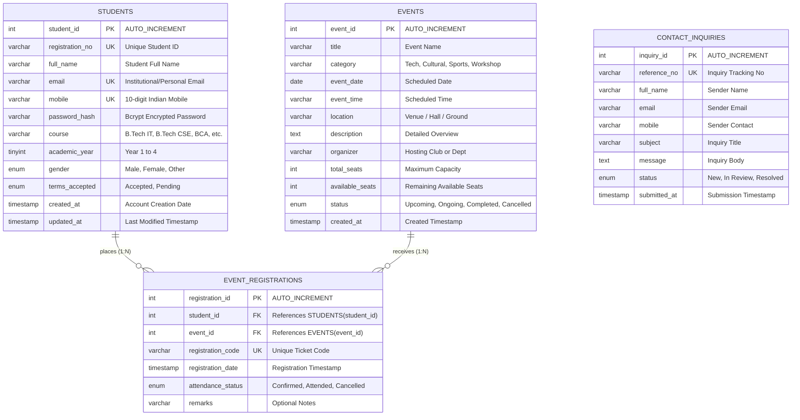

# 📊 StudentHub - Entity-Relationship (ER) Model

**Practical 8:** MySQL Schema Design, ER Model, PDO Connectivity, and Prepared Statements  
**Course:** Web Technology Laboratory  
**Project:** StudentHub Digital Campus Portal  

---

## 📌 1. Overview of ER Model

The StudentHub database is architected using a normalized relational schema (`3NF`) to support student profiles, campus events, event registrations, and campus inquiries with referential integrity.



---

## 🏛️ 2. Entities & Attribute Details

### 2.1 `students` Entity
Represents users registered on StudentHub.

| Attribute | SQL Type | Constraints | Description |
| :--- | :--- | :--- | :--- |
| `student_id` | `INT UNSIGNED` | **PK**, `AUTO_INCREMENT` | Unique internal surrogate identifier |
| `registration_no` | `VARCHAR(30)` | `NOT NULL`, **UNIQUE** | Formatted ID (e.g., `STU20261012001`) |
| `full_name` | `VARCHAR(100)` | `NOT NULL` | Sanitized name of the student |
| `email` | `VARCHAR(120)` | `NOT NULL`, **UNIQUE** | Validated email address |
| `mobile` | `VARCHAR(15)` | `NOT NULL`, **UNIQUE** | 10-digit Indian mobile number |
| `password_hash` | `VARCHAR(255)` | `NOT NULL` | One-way bcrypt hash (`password_hash()`) |
| `course` | `VARCHAR(50)` | `NOT NULL` | Enrolled academic program |
| `academic_year` | `TINYINT UNSIGNED` | `NOT NULL` | Current year of study (`1`, `2`, `3`, `4`) |
| `gender` | `ENUM` | `NOT NULL` | `'Male'`, `'Female'`, `'Other'` |
| `terms_accepted`| `ENUM` | `DEFAULT 'Accepted'` | Terms and conditions acceptance |
| `created_at` | `TIMESTAMP` | `DEFAULT CURRENT_TIMESTAMP` | Account creation timestamp |
| `updated_at` | `TIMESTAMP` | `ON UPDATE CURRENT_TIMESTAMP`| Last record modification time |

---

### 2.2 `events` Entity
Represents all campus events displayed on StudentHub.

| Attribute | SQL Type | Constraints | Description |
| :--- | :--- | :--- | :--- |
| `event_id` | `INT UNSIGNED` | **PK**, `AUTO_INCREMENT` | Unique identifier for event |
| `title` | `VARCHAR(150)` | `NOT NULL` | Title of the event |
| `category` | `VARCHAR(50)` | `NOT NULL` | Category (Technology, Competition, etc.) |
| `event_date` | `DATE` | `NOT NULL` | Scheduled date |
| `event_time` | `VARCHAR(30)` | `NOT NULL` | Scheduled time |
| `location` | `VARCHAR(120)` | `NOT NULL` | Campus venue/room |
| `description` | `TEXT` | `NOT NULL` | Full description |
| `organizer` | `VARCHAR(120)` | `NOT NULL` | Department or club |
| `total_seats` | `INT UNSIGNED` | `NOT NULL` | Total seats available initially |
| `available_seats`| `INT UNSIGNED` | `NOT NULL` | Remaining available seats |
| `status` | `ENUM` | `DEFAULT 'Upcoming'` | Event lifecycle status |
| `created_at` | `TIMESTAMP` | `DEFAULT CURRENT_TIMESTAMP` | Record creation timestamp |

---

### 2.3 `event_registrations` Associative Entity
Resolves the **Many-to-Many (`M:N`)** relationship between `students` and `events`.

| Attribute | SQL Type | Constraints | Description |
| :--- | :--- | :--- | :--- |
| `registration_id`| `INT UNSIGNED` | **PK**, `AUTO_INCREMENT` | Unique registration receipt |
| `student_id` | `INT UNSIGNED` | **FK** (`students`) | References registered student |
| `event_id` | `INT UNSIGNED` | **FK** (`events`) | References selected event |
| `registration_code`| `VARCHAR(50)` | `NOT NULL`, **UNIQUE** | Verification token (e.g. `REG-2026-001`) |
| `registration_date`| `TIMESTAMP` | `DEFAULT CURRENT_TIMESTAMP` | Registration timestamp |
| `attendance_status`| `ENUM` | `DEFAULT 'Confirmed'` | `'Confirmed'`, `'Attended'`, `'Cancelled'` |
| `remarks` | `VARCHAR(255)` | `NULL` | Optional student/admin remarks |

**Composite Key Constraint:**
```sql
UNIQUE KEY `unique_student_event_registration` (`student_id`, `event_id`)
```
> *Guarantees that no student can accidentally or maliciously register for the same event multiple times.*

---

### 2.4 `contact_inquiries` Entity
Stores helpdesk queries submitted through the contact page.

| Attribute | SQL Type | Constraints | Description |
| :--- | :--- | :--- | :--- |
| `inquiry_id` | `INT UNSIGNED` | **PK**, `AUTO_INCREMENT` | Primary key identifier |
| `reference_no` | `VARCHAR(30)` | `NOT NULL`, **UNIQUE** | Ticket reference (e.g. `MSG20261012001`) |
| `full_name` | `VARCHAR(100)` | `NOT NULL` | Name of sender |
| `email` | `VARCHAR(120)` | `NOT NULL` | Contact email |
| `mobile` | `VARCHAR(15)` | `NULL` | Contact mobile |
| `subject` | `VARCHAR(150)` | `NOT NULL` | Inquiry topic |
| `message` | `TEXT` | `NOT NULL` | Inquiry contents |
| `status` | `ENUM` | `DEFAULT 'New'` | Support status (`'New'`, `'In Review'`, `'Resolved'`) |
| `submitted_at` | `TIMESTAMP` | `DEFAULT CURRENT_TIMESTAMP` | Submission timestamp |

---

## 🔗 3. Cardinality & Relationships

1. **Student to Event Registration**:
   - **Cardinality**: `1 : N` (One-to-Many).
   - One student can register for zero, one, or multiple events.
   - Each registration record belongs to exactly one student.
   
2. **Event to Event Registration**:
   - **Cardinality**: `1 : N` (One-to-Many).
   - One event can accept zero, one, or multiple registrations (up to capacity).
   - Each registration record corresponds to exactly one event.

3. **Student to Event (Logical Many-to-Many `M:N`)**:
   - One student can attend multiple events.
   - One event can be attended by multiple students.
   - The relationship is decomposed through the junction table `event_registrations`.

---

## 🛡️ 4. Referential Integrity Rules

- **`ON DELETE CASCADE`**: If a student account is removed, all corresponding event registrations are automatically deleted to avoid orphaned records.
- **`ON UPDATE CASCADE`**: If an event or student primary key changes, dependent foreign keys are automatically updated.

---

## ⚙️ 5. Normalization Summary

- **1NF (First Normal Form)**: All attributes are atomic (no repeating groups, multi-valued fields, or comma-separated values).
- **2NF (Second Normal Form)**: In 1NF and all non-key attributes are fully functionally dependent on the entire primary key (no partial dependencies).
- **3NF (Third Normal Form)**: In 2NF and no transitive functional dependencies exist (non-key attributes depend only on the primary key).
